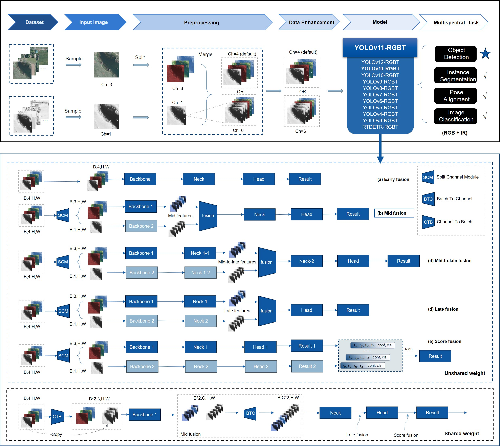

# YOLOv11-RGBT

YOLOv11-based multispectral object detection framework for RGB-T data. This repository is now maintained with a dataset-first workflow: prepare a new aligned RGB/IR dataset, generate a local runtime YAML, and train or validate with YOLOv11-RGBT on the target machine.

[](https://arxiv.org/abs/2506.14696)
[](https://1drv.ms/f/c/384d71bb2abb0199/Eh78MfQQYMNGi1owiw4yqywBHMVzltmccCuPRfkOriALgg?e=wDKPPx)
[](https://drive.google.com/drive/folders/14T2OaLAiMxlx8WJVyJ2x5DLI8RNI0R8m?usp=drive_link)
[](https://pan.baidu.com/s/1Q6H98fiW_f7Kdq6-Ms6oUg?pwd=669j)
[](https://pan.baidu.com/s/1xOUP6UTQMXwgErMASPLj2A?pwd=9rrf)



## Introduction

多光譜（multispectral）影像偵測，特別是結合可見光（RGB）與熱成像（Thermal, IR）的行人與物體偵測技術，近年在電腦視覺領域快速發展。其背後最根本的動機在於不同光譜之間的互補性：RGB 影像提供豐富的紋理、輪廓與色彩資訊，有利於辨識物體的外觀細節與場景結構；熱成像則直接反映物體的溫度分佈，在夜間、逆光、濃霧以及低照度等極端環境下，仍能維持穩定且具對比度的感測能力。相較於單一模態系統，將 RGB 與 IR 進行協同建模，可以在空間細節與熱輻射訊號之間取得互補，使偵測器在光照劇烈變化或背景複雜的情境下，仍能維持較高的召回率與較低的誤警率。因此，在自動駕駛、智慧監控、城市安全監測、工業巡檢與邊境巡查等需要全天候、全場景運作的應用中，多光譜偵測逐漸被視為提升系統穩健性與安全性的關鍵技術路線。

## Project Direction

- This repo is used as a reusable RGB-T training workspace for future datasets, not only KAIST, FLIR, or M3FD.
- The recommended workflow is to keep dataset metadata in a source YAML and generate a machine-local runtime YAML before training.
- The YOLOv11 training interface is preserved, with the RGB-T-specific arguments:
  - `channels=4`
  - `use_simotm="RGBT"`
  - `pairs_rgb_ir=["visible", "infrared"]`
- Older experimental scripts are still present in the repository, but the recommended entry points are the runtime-YAML helpers plus the verified training and validation flow documented below.

## Verified Environment

- Ubuntu 24.04 / WSL2
- Python 3.10
- PyTorch with CUDA
- Recommended virtual environment:

```bash
source ~/.venv310/bin/activate
pip install -r requirements.txt
```

## Recommended Workflow

1. Prepare a pixel-aligned RGB-T dataset with a consistent `visible` and `infrared` layout.
2. Write or reuse a source YAML that records the dataset name, class count, class names, and split names.
3. Generate a runtime YAML on the current machine with `build_rgbt_dataset_yaml.py`.
4. Train with YOLOv11-RGBT using the runtime YAML.
5. Validate the trained checkpoint.
6. Optionally benchmark or export predictions for quick inspection.

## Dataset Layout

The current runtime helper expects the extracted dataset to follow this structure:

```text
<dataset_root>/
├── visible/
│   ├── train/
│   └── test/
├── infrared/
│   ├── train/
│   └── test/
└── labels/
    ├── train/
    └── test/
```

Notes:

- `visible` and `infrared` must contain aligned image pairs.
- `labels` stores YOLO labels for the same samples.
- If your validation split is named `val` instead of `test`, pass `--val-split val --test-split val` when generating the runtime YAML.
- If your modality folder names are different, pass `--visible-dir-name` and `--infrared-dir-name`.

## Source YAML Example

The source YAML can stay small and dataset-focused. It does not need to store the final absolute path of the current machine.

```yaml
path: MyDataset
train: visible/train
val: visible/test
test: visible/test
nc: 3
names: ["person", "car", "bicycle"]
```

If automatic path inference does not match your extracted folder name, provide `--dataset-root` explicitly when building the runtime YAML.

## Build Runtime YAML

### Option 1: Reuse an existing source YAML

```bash
source ~/.venv310/bin/activate

python build_rgbt_dataset_yaml.py \
  --source-yaml /path/to/MyDataset-rgbt.yaml \
  --dataset-root /path/to/extracted/MyDataset/MyDataset \
  --output runs/tmp/MyDataset.runtime.yaml
```

### Option 2: Build from dataset root and class names

```bash
source ~/.venv310/bin/activate

python build_rgbt_dataset_yaml.py \
  --dataset-root /path/to/extracted/MyDataset/MyDataset \
  --output runs/tmp/MyDataset.runtime.yaml \
  --names person car bicycle \
  --nc 3
```

### Optional Environment Variables

If you keep datasets in a fixed location, you can also define:

```bash
export YOLOV11_RGBT_EXTRACTED_ROOT=/path/to/extracted
export YOLOV11_RGBT_YAML_ROOT=/path/to/yaml
```

## Training

### Verified local smoke-test flow

The current repository includes a verified local training wrapper for KAIST-style RGBT training:

```bash
source ~/.venv310/bin/activate

python train_kaist.py \
  --epochs 100 \
  --imgsz 640 \
  --batch 4 \
  --workers 4 \
  --device 0 \
  --exist-ok
```

This script will:

- build a runtime YAML for the current machine,
- launch YOLOv11-RGBT training,
- save outputs under `runs/`,
- record the latest run so validation can find the newest weights automatically.

### Recommended KAIST commands

If you want to verify the full RGB-T training flow with a stable reference dataset first, use `KAIST8-rgbt.yaml`. This is the recommended baseline before switching to a new custom dataset.

#### 1. KAIST smoke test

Purpose: quickly verify that dataset loading, 4-channel RGB-T input, model construction, and one short training run all work on the current machine.

```bash
source ~/.venv310/bin/activate
cd ~/workspace/yolov11-RGBT

python train_rgbt_dataset.py \
  --source-yaml ~/datasets/yolov11_datasets/Datasets/NewVersion/yaml/KAIST8-rgbt.yaml \
  --dataset-root ~/datasets/yolov11_datasets/Datasets/NewVersion/extracted/KAIST8/KAIST8 \
  --model ultralytics/cfg/models/11-RGBT/yolo11-RGBT-midfusion.yaml \
  --pretrained yolo11n.pt \
  --epochs 1 \
  --imgsz 320 \
  --batch 1 \
  --workers 0 \
  --device 0 \
  --fraction 0.02 \
  --project runs/kaist_yolo11n \
  --name smoke \
  --exist-ok
```

#### 2. KAIST formal training

Purpose: train an RGB-T detector with YOLO11-RGBT architecture, initialized from `yolo11n.pt`, using KAIST as the main reference dataset.

```bash
source ~/.venv310/bin/activate
cd ~/workspace/yolov11-RGBT

python train_rgbt_dataset.py \
  --source-yaml ~/datasets/yolov11_datasets/Datasets/NewVersion/yaml/KAIST8-rgbt.yaml \
  --dataset-root ~/datasets/yolov11_datasets/Datasets/NewVersion/extracted/KAIST8/KAIST8 \
  --model ultralytics/cfg/models/11-RGBT/yolo11-RGBT-midfusion.yaml \
  --pretrained yolo11n.pt \
  --epochs 100 \
  --imgsz 640 \
  --batch 4 \
  --workers 4 \
  --device 0 \
  --project runs/kaist_yolo11n \
  --name train_v1 \
  --exist-ok
```

### Recommended pattern for a new dataset

After generating `runs/tmp/MyDataset.runtime.yaml`, train with the same RGBT arguments:

```python
from ultralytics import YOLO

model = YOLO("ultralytics/cfg/models/11-RGBT/yolo11-RGBT-midfusion.yaml")
model.train(
    data="runs/tmp/MyDataset.runtime.yaml",
    epochs=100,
    imgsz=640,
    batch=4,
    device="0",
    workers=4,
    channels=4,
    use_simotm="RGBT",
    pairs_rgb_ir=["visible", "infrared"],
    project="runs/mydataset",
    name="train",
)
```

## Validation

### Verified local validation flow

```bash
source ~/.venv310/bin/activate

python val_kaist.py \
  --imgsz 640 \
  --batch 4 \
  --workers 4 \
  --device 0 \
  --exist-ok
```

If `--weights` is omitted, the script automatically looks for the latest checkpoint under `runs/`.

### Validate a specific checkpoint

```bash
source ~/.venv310/bin/activate

python val_kaist.py \
  --weights /path/to/best.pt \
  --imgsz 640 \
  --batch 4 \
  --workers 4 \
  --device 0
```

### Recommended KAIST validation command

Purpose: evaluate the trained KAIST RGB-T checkpoint and report detection metrics on the validation split.

```bash
source ~/.venv310/bin/activate
cd ~/workspace/yolov11-RGBT

python val_rgbt_dataset.py \
  --source-yaml ~/datasets/yolov11_datasets/Datasets/NewVersion/yaml/KAIST8-rgbt.yaml \
  --dataset-root ~/datasets/yolov11_datasets/Datasets/NewVersion/extracted/KAIST8/KAIST8 \
  --weights runs/kaist_yolo11n/train_v1/weights/best.pt \
  --imgsz 640 \
  --batch 4 \
  --workers 4 \
  --device 0 \
  --project runs/kaist_yolo11n \
  --name val_v1 \
  --exist-ok
```

## Benchmark and Quick Demo

For quick validation plus exported examples, use:

```bash
source ~/.venv310/bin/activate

python bench_and_demo_rgbt.py \
  --weights /path/to/best.pt \
  --data /path/to/MyDataset-rgbt.yaml \
  --imgsz 640 \
  --batch 1 \
  --workers 0 \
  --iters 20 \
  --n_images 8 \
  --out_dir runs/bench_demo
```

This script generates a runtime YAML automatically, runs validation, estimates throughput, and writes demo predictions for inspection.

## Useful Scripts

- `build_rgbt_dataset_yaml.py`: build machine-local runtime YAML files for RGB-T datasets
- `rgbt_dataset_runtime.py`: shared runtime YAML helper used by benchmark and dataset tooling
- `train_kaist.py`: verified local training wrapper
- `val_kaist.py`: verified local validation wrapper
- `bench_and_demo_rgbt.py`: validation, timing, and qualitative demo export
- `bench_m3fd_models.py`: benchmark helper for existing M3FD-style experiments

## Practical Notes

- The repository is designed to move across machines; avoid hard-coding absolute dataset paths inside tracked YAML files.
- For a new dataset, prefer adding one clean source YAML and generating runtime YAML files under `runs/tmp/`.
- Keep large files such as datasets, checkpoints, and training logs outside version control.
- When migrating from another machine, validate the dataset layout first, then regenerate the runtime YAML locally before training.
- The current YOLO11-RGBT mid-fusion models use `4` input channels: `RGB` from `visible` plus `T` from `infrared`.

## Git Update Workflow

Use the following commands when you update this README in the standalone workspace and want to sync it into the GitHub-tracked `Multimodality` repository.

#### 1. Copy the updated README into the tracked repository

Purpose: sync the local working copy of `YOLOv11-RGBT/README.md` into the Git repository that is connected to GitHub.

```bash
cp ~/workspace/yolov11-RGBT/README.md ~/workspace/Multimodality/YOLOv11-RGBT/README.md
```

#### 2. Inspect Git status

Purpose: confirm which files changed before staging or committing.

```bash
cd ~/workspace/Multimodality
git status -sb
```

#### 3. Review README diff

Purpose: inspect the exact README changes before committing.

```bash
cd ~/workspace/Multimodality
git diff -- YOLOv11-RGBT/README.md
```

#### 4. Commit and push

Purpose: stage the updated README, create a commit, and upload it to `origin/main`.

```bash
cd ~/workspace/Multimodality
git add YOLOv11-RGBT/README.md
git commit -m "Update YOLOv11-RGBT README for dataset-first workflow"
git push origin main
```

## Citation

If this repository or the associated paper helps your work, please cite:

```bibtex
@article{yolov11_rgbt_2025,
  title   = {YOLOv11-RGBT: Towards a Comprehensive Single-Stage Multispectral Object Detection Framework},
  author  = {YOLOv11-RGBT Authors},
  journal = {arXiv preprint arXiv:2506.14696},
  year    = {2025}
}
```
